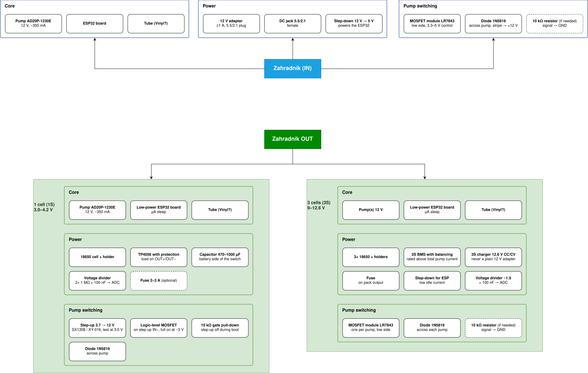

# Zahradník

An ESP32 powered device to automatically water plants.

## The Idea

An ESP32 used as a brain that talks to a remote server. It measures soil moisture with capacitive sensors and remaining water level if water tank is used and sends it to a server which tells it to water the plants. In an emergency (drought and no server connection) it can decide by itself.

Device can be powered solely through an electric outlet or via a battery that is recharged either with an outlet or a solar panel.

<!-- ### Implemented: -->

### To be implemented:

#### Phase I.
- [ ] ESP32 can turn on a pump
- [ ] Device is outlet powered

#### Phase II (IN version)
- [ ] Device can use sensors to measure
    - [ ] soil moisture
    - [ ] water level

#### Phase III. (OUT version)
- [ ] Device is battery powered
- [ ] Battery can be recharged from an outlet (or a solar panel)

### Components used:
- Vodotěsné mini čerpadlo AD20P-1230E, 240l/h, 12V (https://www.laskakit.cz/vodotesne-mini-cerpadlo-ad20p-1230e--240l-h--12v/)

#### Hardware mind map

<!-- ### Future version: -->
