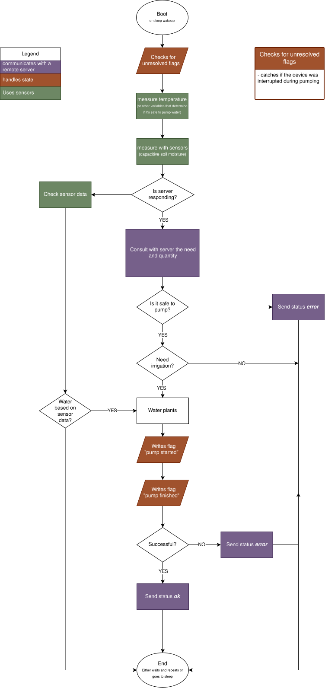
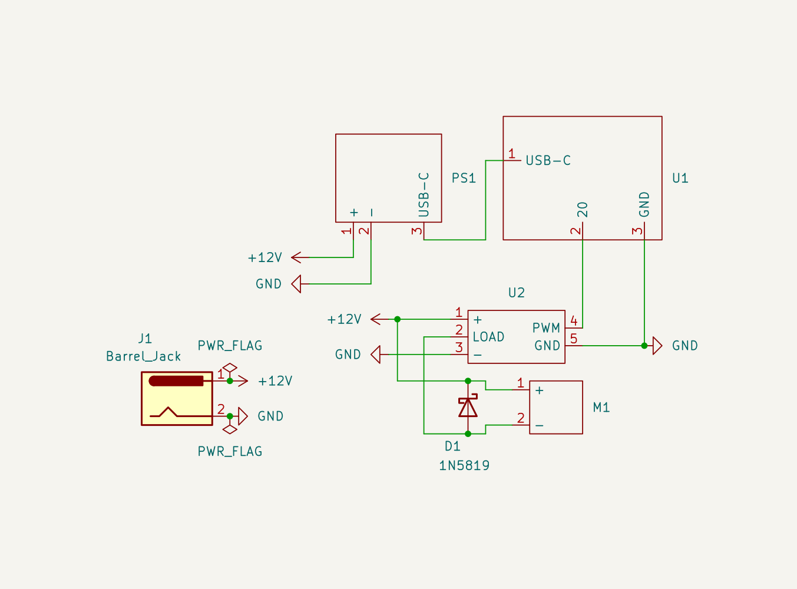

# Zahradník

An ESP32 powered device to automatically water plants (Automatic Irrigation).

## The Idea

An ESP32 used as a brain that talks to a remote server. It measures soil moisture with capacitive sensors and remaining water level if water tank is used and sends it to a server which tells it to water the plants. In an emergency (drought and no server connection) it can decide by itself.

Whether the device will be powered from an adapter or a battery is still an open question. Both versions may be developed.

## Features

| Must have | Should have | Could have |
| --------------- | --------------- | --------------- |
| Waters plants with a pump | Sense remaining water level | Sense temperature |
| Measures soil moisture | | Be able to check the weather (for outside version, the device does not need to water plants if in the next few minutes it'l start raining) |
| Sends data and comunicates with remote server | | |

## Software

The folowing flowchart shows the device's actions ones it boots (or wakes up).

## Hardware

The final form of hardware is not yet decided, instead of commiting to one design, many versions will be built, tested and compared.

### First build - Adapter IN (inside) version

##### Phase I.

- [ ] ESP32 can turn on a pump
- [ ] Device is outlet powered

The first build of Zahradník. Powered with a 12V DC adapter, it needs no battery. Device uses a step down converter to power an esp32c6 in addition to the pump. Sensors will be added in phase II.

| general component | specific part | url | quantity | cost | have | additional notes |
| :--- | :--- | :--- | :--- | :--- | :--- | :--- |
| ESP32 board | ESP32-C6 16MB Flash WiFi Bluetooth IoT modul | https://www.laskakit.cz/esp32-c6-16mb-flash-wifi-bluetooth-iot-modul/ | 1 | TRUE |  |
| Pump | Vodotěsné mini čerpadlo AD20P-1230E, 240l/h, 12V | https://www.laskakit.cz/vodotesne-mini-cerpadlo-ad20p-1230e--240l-h--12v/ | 1 | TRUE |  |
| Adapter | Síťový napájecí adaptér 12V/1A 5,5/2,1mm | https://www.laskakit.cz/napajeci-adapter-sitovy-1000ma-5-5-2-1-mm-12v/ | 1 | TRUE |  |
| DC jack | Konektor DC 5.5/2.1mm 18AWG samec 30cm kabel | https://www.laskakit.cz/konektor-dc-5-5-2-1mm-samec-25cm-kabel/ | 1 | TRUE |  
|  | Konektor DC 5.5/2.1mm 18AWG samice 30cm kabel | https://www.laskakit.cz/konektor-dc-5-5-2-1mm-samice-25cm-kabel/ | 1 | TRUE |  |
| Mosfet (logic level) | PWM MOSFET modul LR7843, 30VDC 161A | https://www.laskakit.cz/pwm-mosfet-modul-lr7843--30vdc-161a/ | 1 | TRUE |  
| Step down converter | Step-down měnič 12V-5V/3A, USB-C | https://www.laskakit.cz/step-down-menic-12v-5v-3a--usb-c/ | 1 | TRUE | powers board directly with USB-C |
| Flyback diode | Microdiode Electronics Schottkyho dioda 1N5819 40V 1A DO41 | https://www.laskakit.cz/schottkyho-dioda-1n5819-40v-1a-do41/ | 1 | TRUE |  

##### Phase II

- [ ] Device can use sensors to measure
    - [ ] soil moisture
    - [ ] water level

